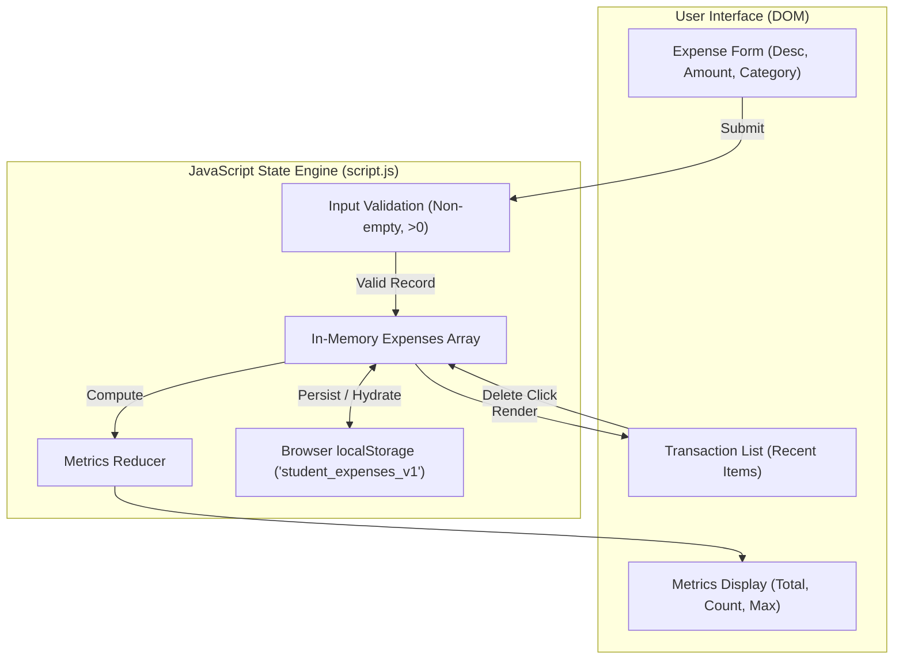

# Student Expense Tracker

> **Lightweight, Responsive Personal Expense Logging & Budget Management Application**

[](https://developer.mozilla.org/en-US/docs/Web/HTML)
[](https://developer.mozilla.org/en-US/docs/Web/CSS)
[](https://developer.mozilla.org/en-US/docs/Web/JavaScript)
[](tests/test_expense_tracker.mjs)
[](https://opensource.org/licenses/MIT)

---

## 1. Project Title & Overview

**Student Expense Tracker** is a clean, dependency-free web application engineered to help students monitor daily expenditures, categorize personal outflows, and maintain spending awareness.

The application features instant dynamic metric cards (Total Outflow, Transaction Count, Largest Expense), an intuitive category selection system, inline record deletion, and client-side `localStorage` persistence ensuring user data remains available across browser sessions without requiring an external database.

---

## 2. Problem Being Solved

College students frequently experience month-end budget deficits due to unmonitored small daily expenses (canteen snacks, local commutes, printing, subscriptions):
1. **Friction of Heavy Financial Apps:** Banking apps and commercial budgeting platforms demand account linking, KYC, or complex category setups, discouraging consistent daily logging.
2. **Lack of Instant Feedback:** Without a visible running total and transaction count, users underestimate their cumulative micro-spending.
3. **Privacy Concerns:** Students often prefer not to expose their day-to-day spending logs to cloud services or third-party financial aggregators.

Student Expense Tracker provides an instantaneous, private, zero-setup ledger directly in the browser.

---

## 3. Main Features

- 💸 **Instant Expense Logging:** Add transactions with description, rupee amount (₹), and category in one click.
- 🏷️ **Categorized Outflow Tagging:** Preset categories tailored to student life:
  - 🍔 Food & Dining
  - 🚇 Transportation
  - 📚 Books & Study
  - 🏠 Hostel & Rent
  - 🎬 Entertainment
  - 📦 Other
- 📊 **Dynamic Metric Cards:**
  - **Total Outflow:** Real-time cumulative sum in INR.
  - **Transactions:** Count of active logged items.
  - **Largest Expense:** Highlights the single highest expense to spot major spending spikes.
- 💾 **Client-Side LocalStorage Persistence:** Records are serialized to browser storage (`student_expenses_v1`), preserving records across page refreshes and browser restarts.
- 🗑️ **Inline Deletion & Total Recalculation:** Remove incorrect entries with a single click, instantly adjusting totals.
- 📱 **Responsive Dark Theme:** Modern, ergonomic dark theme built with CSS custom properties, fully optimized for both desktop and mobile screens.

---

## 4. Technology Stack

| Layer | Technologies |
|---|---|
| **Markup** | HTML5 Semantic Elements (`<header>`, `<section>`, `<form>`, `<main>`, `<footer>`) |
| **Styling** | Modern CSS3 (CSS Custom Properties, Flexbox, CSS Grid, Media Queries) |
| **Scripting** | Pure Vanilla JavaScript (ES6+ Modules, DOM API, `localStorage` API) |
| **Typography** | Inter (Google Fonts) |
| **Testing** | Node.js Test Runner with `node:assert` (`tests/test_expense_tracker.mjs`) |

---

## 5. Application Architecture & Data Flow



---

## 6. Installation Instructions

No package installation or compiler build step is required!

```bash
# Clone the repository
git clone https://github.com/nish1923/expense-tracker.git
cd expense-tracker
```

---

## 7. Local Execution Instructions

### Option 1: Direct Browser Launch
Simply double-click `index.html` or open it from terminal:
```bash
# macOS
open index.html

# Linux
xdg-open index.html

# Windows
start index.html
```

### Option 2: Local HTTP Server
```bash
# Using Python 3 built-in HTTP server
python3 -m http.server 8080

# Or using npx serve
npx serve .
```
Visit [http://localhost:8080](http://localhost:8080) in your browser.

---

## 8. Environment-Variable Setup

This is a standalone, client-side web application.  
**No environment variables or API keys are required.**

---

## 9. API / Database Requirements

- **External APIs:** None. Fully operational offline.
- **Database:** Uses standard HTML5 `Window.localStorage` for zero-configuration, privacy-preserving local persistence.

---

## 10. Testing & Verification Instructions

The application logic (state mutations, mathematical aggregations, and input sanitization) is validated using an automated test suite:

```bash
npm test
# Or directly via Node.js:
node tests/test_expense_tracker.mjs
```

### Verification Results
```
=== Student Expense Tracker Verification Suite ===
✓ Test 1 Passed: Empty state returns zero totals
✓ Test 2 Passed: Adding multiple categorized expenses aggregates correctly (₹450 total, ₹250 max)
✓ Test 3 Passed: Rejection of empty descriptions, zero amounts, and negative numbers
✓ Test 4 Passed: Deletion recalculates metrics correctly
ALL 4 EXPENSE TRACKER VERIFICATION TESTS PASSED!
```

---

## 11. Deployment Instructions

### GitHub Pages (Recommended)
1. In repository settings, navigate to **Pages**.
2. Source: **Deploy from a branch**.
3. Branch: `main` (or `portfolio/audit-repair-nish1923`), folder: `/ (root)`.
4. Click **Save**. The application will be live immediately at `https://nish1923.github.io/expense-tracker/`.

### Vercel / Netlify
Can be dragged and dropped directly or deployed as a static zero-config site.

---

## 12. Known Limitations

- **Cross-Device Sync:** Data is stored locally in the current browser's storage; clearing browser cache will erase saved records.
- **Export Formats:** CSV export is not yet available in v1.0.

---

## 13. Future Improvements

- [ ] **CSV / PDF Statement Export:** Download month-end spending summary reports.
- [ ] **Category Pie Chart:** Visual breakdown of spending by percentage using Chart.js or Canvas API.
- [ ] **Monthly Budget Cap & Alerts:** Set monthly allowance (e.g. ₹5,000) with visual progress bar warning when 80% is reached.

---

## Author & Maintainer

**Nischal S** ([@nish1923](https://github.com/nish1923))  
Email: [nischal.ns7770@gmail.com](mailto:nischal.ns7770@gmail.com)  
Project Repository: [https://github.com/nish1923/expense-tracker](https://github.com/nish1923/expense-tracker)
